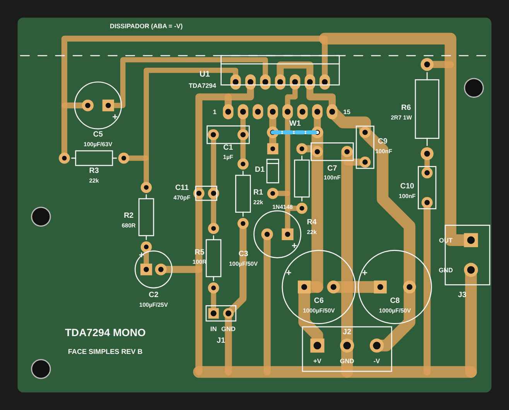
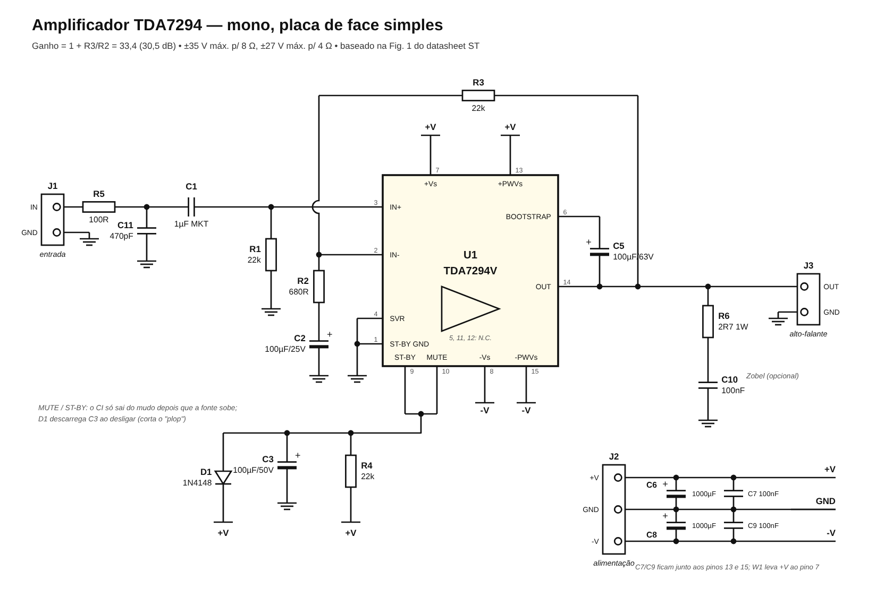
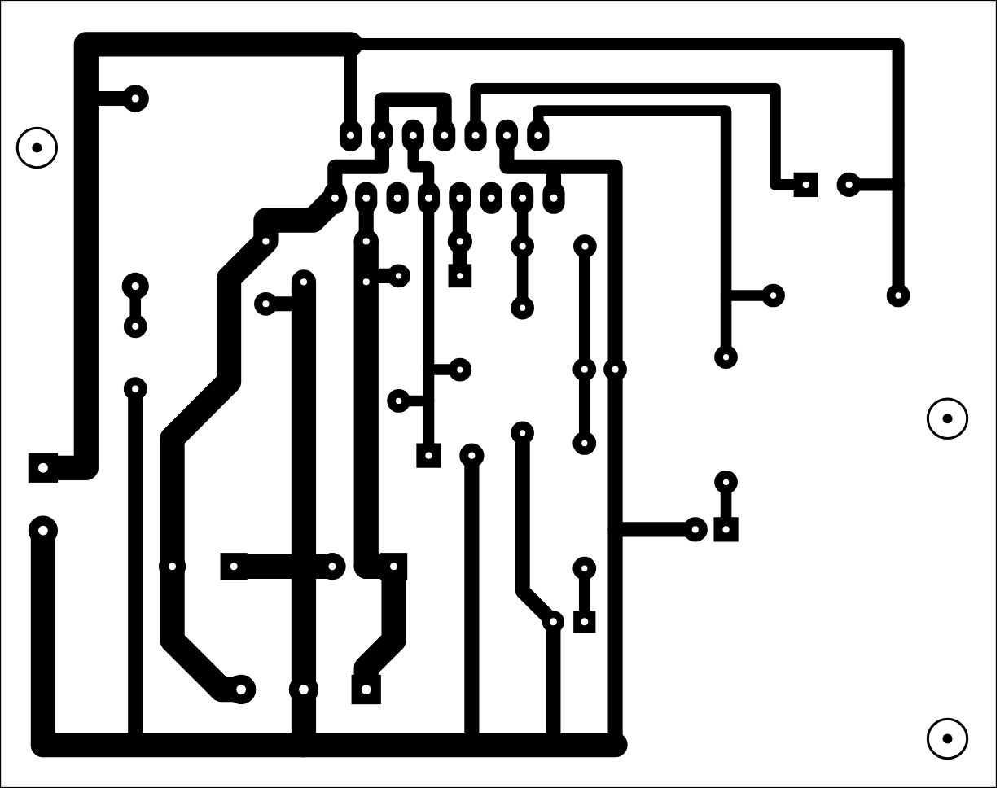
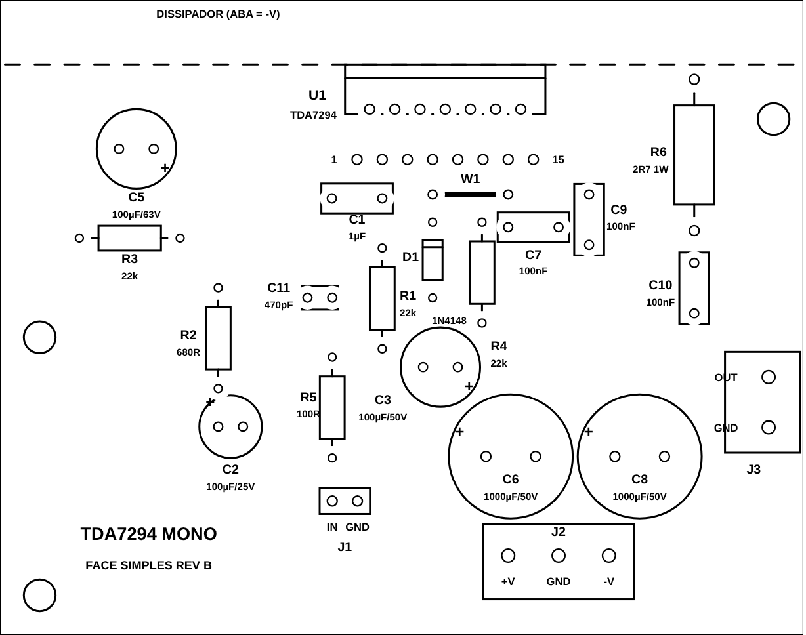

# Amplificador TDA7294 — mono, placa de face simples

Amplificador de potência com o **TDA7294** (ST, DMOS, Multiwatt15), montado numa
**placa de face simples** (cobre só de um lado) de **81 × 64 mm**. Tem só **um
jumper**, as trilhas são largas e a isolação mínima é de 0,45 mm, então dá para
fazer a placa em casa por transferência térmica ou mandar fabricar.

O circuito segue a **Figura 1 (Typical Application) do datasheet da ST**, com
algumas mudanças:

- C1, C2 e C5 maiores, para grave firme e com pouca distorção (veja *Grave*).
- MUTE e ST-BY ligados juntos: o CI liga sozinho com a fonte.
- C3 de 100 µF, para atrasar a saída do mudo, e diodo D1 que corta o "plop" ao desligar.
- Filtro de RF na entrada (R5 e C11).



## Características

| Item | Valor |
|---|---|
| Ganho | 1 + R3/R2 = 1 + 22k/680 ≈ **33,4× (30,5 dB)** |
| Sensibilidade | ≈ 0,7 V RMS para potência máxima em 8 Ω (nível de linha) |
| Impedância de entrada | 22 kΩ (R1) |
| Filtro de RF na entrada | 100 Ω + 470 pF, corte em ≈ 3,4 MHz |
| Corte inferior | ≈ 7 Hz (C1/R1) e ≈ 2,3 Hz (C2/R2) |
| Alimentação | simétrica, **±35 V máx. para 8 Ω** ou **±27 V máx. para 4 Ω** |
| Potência | cerca de 70 W (THD 10 %) em qualquer um dos dois casos acima, ≈ 50 W com baixa distorção |
| Trilhas de potência | 2 mm: bastam para **8 Ω** (≈ 4,2 A de pico a 70 W). Para 4 Ω, estanhe as trilhas grossas |
| Proteções (internas do CI) | curto-circuito na saída, térmica, mute/stand-by |

## Esquema



Arquivo vetorial: [`esquema.svg`](esquema.svg).

Ligações que não aparecem no desenho do CI:

- **Pino 4 (SVR)** e **pino 1 (ST-BY GND)** vão direto ao terra, como na Fig. 1 do datasheet.
- **Pinos 9 e 10** ficam unidos. R4 os puxa para +V e C3 (100 µF) segura o CI em
  mudo por cerca de 0,25–0,3 s enquanto a fonte sobe. Ao desligar, D1 descarrega C3
  pelo +V e o CI volta a mudo antes que as tensões caiam (sem "plop").
- **Pinos 5, 11 e 12 são N.C.** O pad do pino 12 serve só de passagem para a trilha
  de -V (veja *Montagem*).

## Lista de material (por canal)

| Ref | Valor | Observação |
|---|---|---|
| U1 | **TDA7294V** | Multiwatt15 vertical, em dissipador |
| R1, R3, R4 | 22 kΩ 1/4 W | filme metálico 1 % de preferência |
| R2 | 680 Ω 1/4 W | define o ganho com R3 |
| R5 | 100 Ω 1/4 W | filtro de RF da entrada |
| R6 | 2,7 Ω 1 W | Zobel, **opcional** |
| C1 | 1 µF poliéster (MKT) | passo 5 mm |
| C2 | 100 µF / 25 V | eletrolítico radial 6,3 mm, passo 2,5 |
| C3 | 100 µF / 50 V | eletrolítico radial 8 mm, passo 3,5 |
| C5 | 100 µF / 63 V | bootstrap, radial 8 mm, passo 3,5 (procure a versão de 8 × 11,5 mm) |
| C6, C8 | 1000 µF / 50 V | radial 12,5 mm, passo 5 |
| C7, C9 | 100 nF / 100 V | poliéster, passo 5 mm |
| C10 | 100 nF / 100 V | Zobel, **opcional**, passo 5 mm |
| C11 | 470 pF / 50 V | cerâmico C0G/NP0, passo 2,5 mm (filtro de RF) |
| D1 | 1N4148 | |
| J1 | barra de pinos 2 vias 2,54 mm | na borda de baixo; ou solde direto o cabo blindado |
| J2 | borne KF301 3 vias 5,08 mm | +V / GND / -V |
| J3 | borne KF301 2 vias 5,08 mm | alto-falante |
| W1 | jumper de fio rígido | ~8 mm |
| — | dissipador ≤ 1,5 °C/W, mica ou silicone isolante, bucha e parafuso M3 | a aba do CI está em **-V** |

Também em CSV: [`pcb/lista_de_material.csv`](pcb/lista_de_material.csv).

## Arquivos da placa

| Arquivo | Para quê |
|---|---|
| [`pcb/impressao_A4_escala_1-1.pdf`](pcb/impressao_A4_escala_1-1.pdf) | **Imprimir e transferir.** Pág. 1: cobre espelhado. Pág. 2: cobre visto de cima. Pág. 3: guia de montagem. Cada página tem uma régua de 50 mm para conferir a escala. |
| [`pcb/cobre_espelhado_transferencia.svg`](pcb/cobre_espelhado_transferencia.svg) | cobre espelhado em SVG (1:1, unidades em mm) |
| [`pcb/serigrafia_componentes.svg`](pcb/serigrafia_componentes.svg) | posição dos componentes |
| [`pcb/gerber/tda7294_mono_gerber.zip`](pcb/gerber/tda7294_mono_gerber.zip) | Gerber + furação para mandar fabricar (1 camada, cobre embaixo, serigrafia em cima) |




### Fazendo em casa (transferência térmica)

1. Imprima a **página 1** do PDF numa impressora **a laser**, em escala **100 %**
   (desmarque "ajustar à página"). Confira a régua de 50 mm.
2. Transfira para uma placa de fenolite ou fibra de vidro de face simples e corroa
   com percloreto de ferro.
3. Brocas: **0,8 mm** (resistores e diodo), **0,9 mm** (capacitores e jumper), **1,0 mm**
   (TDA7294, eletrolíticos grandes e J1), **1,3 mm** (bornes) e **3,2 mm** (fixação). Os
   pontos brancos no centro das ilhas guiam a broca.

### Mandando fabricar

Envie o `.zip` de Gerber pedindo **1 camada**, FR-4 de 1,6 mm e cobre de 1 oz (2 oz é
melhor). O cobre fica na face de baixo (`B_Cu`), com máscara de solda embaixo e
serigrafia em cima.

## Montagem

1. **W1**: solde primeiro o jumper de fio. Ele leva +V ao pino 7 e passa por cima
   da trilha do MUTE.
2. Resistores, D1 (a faixa do catodo fica do lado do quadrado, voltado para cima),
   C11 e a barra de pinos J1. O cabo blindado da entrada chega pela borda de baixo
   da placa, sem passar por cima da parte de potência.
3. Capacitores de poliéster e depois os eletrolíticos. **Atenção à polaridade:** o
   pad quadrado é o **+**.
   - C8 tem o **+ no GND** e o **− no -V**. Isso é o certo para o lado negativo.
   - C5 tem o **+ no pino 6** e o **− na saída**.
4. Bornes J2 e J3.
5. **TDA7294 por último.** Prenda-o primeiro no dissipador, com isolante e bucha,
   e só depois encaixe e solde os pinos. Assim os terminais não ficam forçados. A linha
   tracejada na serigrafia marca a face da aba: o dissipador fica atrás dela, sobre
   a faixa de 6,5 mm da borda (só passam trilhas ali, nada de componente).
6. **Pino 12:** é N.C. no TDA7294, e o pad dele só serve de passagem para a trilha
   de -V. Pode soldar normalmente. Se preferir não deixar nada ligado ao pino, corte
   o terminal 12 rente ao corpo antes de encaixar: a trilha continua passando pelo pad.

> **A aba metálica do TDA7294 está ligada ao -V.** Se o dissipador encostar no
> chassi (terra), use mica ou silicone isolante e bucha no parafuso. Antes de ligar,
> meça com o multímetro que a aba não está em curto com o dissipador.

## Grave

O amplificador é plano até poucos hertz. Quem define o grave que você ouve é principalmente
**o alto-falante e a caixa**. Do lado do amplificador, o que faz diferença é:

- **C5 = 100 µF (bootstrap).** Mantém o estágio de saída com força total em 30–40 Hz na
  potência máxima. Com valor pequeno, o grave "afina" justamente quando você aumenta o volume.
- **C2 = 100 µF.** Com ele, a tensão sobre esse eletrolítico em 20 Hz é muito pequena, e
  o capacitor praticamente não gera distorção no grave.
- **C1 = 1 µF de poliéster (MKT).** Corte em ≈ 7 Hz, sem eletrolítico no caminho do sinal.
- **Fonte com reserva.** Um bumbo forte puxa vários ampères por poucos milissegundos. Use
  **10000 µF por trilho** na fonte e um transformador folgado (≈ 120 VA por canal). Fonte
  fraca é a causa mais comum de grave "mole" ou que distorce cedo.
- **Fios curtos e grossos** da fonte até J2 e de J3 até o alto-falante (1,5 mm² ou mais).

Se quiser **mais** grave do que a gravação tem (reforço tipo *loudness*), isso se faz antes
do amplificador: no pré, no equalizador ou na fonte de som. Um reforço no próprio amplificador
faz ele saturar mais cedo exatamente nas notas graves.

## Fonte de alimentação (fora da placa)

A placa recebe ±V já retificado e filtrado no borne J2. Uma fonte simples:

- **Transformador com tomada central** (secundário 2 × V AC):
  - alto-falante de **8 Ω**: 2 × 24–25 V AC → cerca de ±34 V DC;
  - alto-falante de **4 Ω**: 2 × 18–19 V AC → cerca de ±26 V DC;
  - potência: ~120 VA para um canal, 200–250 VA para estéreo.
- Ponte retificadora de **25 A** (ex.: KBPC2510).
- **2 × 10000 µF / 50 V** (um em +V e outro em -V; 4700 µF funciona, mas segura menos o grave), com a terra central
  ligada ao centro do transformador.
- **Fusível** no primário (lento: 1 A em 220 V ou 2 A em 127 V, para ~200 VA).

Para estéreo, monte **duas placas** na mesma fonte e puxe fios separados de +V/GND/-V
para cada uma (ligação em estrela). O GND do alto-falante já volta pela placa até o
borne J2, que é o ponto estrela da placa.

## Primeiro teste

1. **Sem alto-falante.** Ligue a fonte por uma **lâmpada incandescente em série no
   primário** (60–100 W), que limita o estrago se houver erro de montagem.
2. Meça ±V no J2. A lâmpada deve acender e apagar (carga dos capacitores) e ficar
   apagada.
3. Meça a tensão DC na saída (J3 OUT contra GND): deve ficar **abaixo de ±50 mV**
   (normalmente só alguns mV).
4. Meça os pinos 9/10 em relação ao GND: devem estar **acima de 3,5 V** (o CI está
   operando). Abaixo de 1,5 V, o CI está em stand-by.
5. Com tudo certo, tire a lâmpada, ligue o alto-falante e toque com o volume baixo.
6. Depois de alguns minutos tocando alto, o dissipador pode ficar morno ou quente,
   mas deve dar para segurar.

## Detalhes do projeto da placa

Numa placa de face simples, a fileira de trás do Multiwatt15 (pinos pares) fica
"presa" entre o corpo do CI e a fileira da frente. Para não precisar de vários
jumpers, o layout usa dois recursos:

- As trilhas dos pinos **2, 6, 8 e 14** saem **por trás** dos pinos, debaixo do
  corpo do CI, numa faixa de 6,5 mm junto à borda que fica sob o dissipador.
  A saída (pino 14) corre por ali tanto para a esquerda (C5 e realimentação R3) quanto
  para a direita (alto-falante).
- O **canal entre as duas fileiras** leva três ligações: o GND dos pinos 4 e 1, a união
  dos pinos 9 e 10, e o -V do pino 12 ao 15. O pino 8 chega ao pino 12 por trás,
  passando por cima do pino 10.

Com isso, sobra apenas o jumper **W1** (+V do pino 7). O terra é em estrela: a trilha
grossa de baixo junta a terra de sinal (esquerda), a do mudo, a dos filtros e a do
alto-falante no borne J2.

Outros cuidados do layout:

- **Pads ovais** (1,8 × 2,6 mm) no TDA7294, para sobrar mais cobre em volta do furo
  de 1,0 mm. O pino 1 é indicado pelo "1" na serigrafia.
- **C7 e C9** (100 nF) ficam a cerca de 5–6 mm dos pinos 13 e 15.
- **+V e -V** saem do CI em direções opostas: a trilha +V é mais estreita nos primeiros
  milímetros e a -V sai em diagonal. Assim os dois trilhos ficam bem afastados, sem o
  risco de curto que existia na revisão A.

### Regenerar os arquivos

Os arquivos são gerados por scripts em Python 3, sem dependências externas. As imagens
e o PDF usam Node com Playwright.

```bash
cd tools
python3 build.py        # verifica isolação e continuidade e gera SVG, Gerber e lista de material
python3 schematic.py    # gera esquema.svg
node export.js          # gera os PNG em img/ e o PDF de impressão
```

A posição dos componentes e as trilhas estão em [`tools/board.py`](tools/board.py).
O `build.py` falha se alguma trilha ficar a menos de 0,45 mm de outra rede ou se
alguma rede ficar interrompida.
